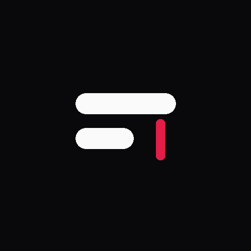
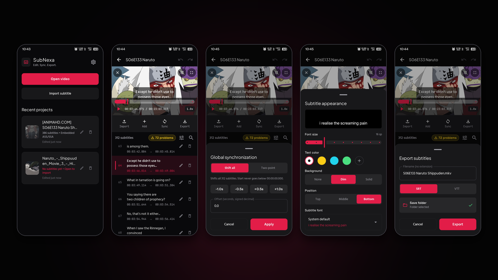

<div align="center">



# SubNexa

**Edit. Sync. Export.**

A simple, offline subtitle editor for Android.

[](https://github.com/pabitra-senpai/SubNexa/releases/latest/download/SubNexa.apk)


<br />



</div>

---

## What it does

Open a video, load a subtitle file, fix it while the video plays, and export a clean copy.

SubNexa edits **subtitles only**. Your video is just a reference and is never changed.

## Features

**Play**
- Play local videos with speed control and fullscreen
- Subtitles appear on the video as you edit

**Import**
- Open **SRT** and **VTT** files
- Read subtitles **stored inside a video** (MKV, MP4): SRT, ASS/SSA, WebVTT and MP4 text tracks
- Bengali, Hindi and English text shown correctly, with automatic text-encoding detection

**Edit**
- Change text and timing of any line
- Add, delete, duplicate, split or merge lines
- Nudge the start, the end, or the whole line in small steps
- Find and replace across all subtitles
- **Remove duplicates** in one tap
- **Undo and redo** every change

**Sync**
- Shift all subtitles earlier or later in one tap
- **Two-point sync** fixes subtitles that slowly drift out of time

**Check**
- A problem counter flags lines that overlap, are empty, too short, too long, or read too fast

**Style**
- Change size, text color, background (none, dim, solid) and position (top, middle, bottom), live on the video
- Bundled fonts for Bengali, Hindi and English, or add your own `.ttf`, `.otf` or `.ttc` font
- Set your default style, export format and theme in Settings (dark or AMOLED black)

**Export**
- Save as **SRT** or **VTT** to any folder you choose

**Projects**
- Recent projects with video thumbnails
- Rename or delete a project
- **Autosave**, and resume where you left off

## Install

1. Tap **Download APK** above (or open [Releases](https://github.com/pabitra-senpai/SubNexa/releases/latest)).
2. Open the downloaded `SubNexa.apk` on your phone.
3. Allow installing from this source if Android asks.

Works on Android 8.0 and newer. Installing a new version over the old one keeps your projects.

## How to use

1. Tap **Open video**.
2. Choose a subtitle: import an SRT/VTT file, or use a track found inside the video.
3. Edit lines while the video plays. Tap **Sync** if the timing is off.
4. Tap **Export**, pick SRT or VTT and a folder.

## Privacy

No account. Works offline. No ads. No tracking. The app asks for no personal data and only opens the files you pick.

The internet is used only when you tap **Check for Updates**. An update is checked with SHA-256 and installed only after you confirm it in Android.

## Build it yourself

You need JDK 17 and the Android SDK. The Gradle wrapper downloads Gradle 9.3.1 automatically.

```bash
git clone https://github.com/pabitra-senpai/SubNexa.git
cd SubNexa
./gradlew assembleDebug      # APK in app/build/outputs/apk/debug/
./gradlew testDebugUnitTest  # run unit tests
```

Every push to `main` is built, tested and released automatically by GitHub Actions.

<details>
<summary><b>Release signing</b></summary>

<br />

Release APKs are signed with your own private key, never a debug key. Keep this key safe: if you lose it, existing users cannot update the app without uninstalling it first.

1. Create a keystore once (needs JDK):

   ```bash
   keytool -genkeypair -v -keystore release.jks -alias upload \
     -keyalg RSA -keysize 4096 -validity 10000
   base64 -w 0 release.jks > release.keystore.base64
   ```

2. In GitHub go to **Settings > Secrets and variables > Actions** and add:

   | Secret | Value |
   | --- | --- |
   | `KEYSTORE_BASE64` | contents of `release.keystore.base64` |
   | `STORE_PASSWORD` | keystore password |
   | `KEY_PASSWORD` | key password |
   | `KEY_ALIAS` | optional, defaults to `upload` |

3. Back up `release.jks` and the passwords somewhere private. Never commit them (they are in `.gitignore`).

For a local signed build, put `release.jks` in the project root and set `STORE_PASSWORD` and `KEY_PASSWORD`, then run `./gradlew assembleRelease`.

**Versioning:** CI sets the version automatically. `versionCode` is the build time in minutes since the Unix epoch, so it always increases. `versionName` is `1.0.<run number>` for `main` builds, or the tag name for `v*` tags (for example `v1.2.0` gives `1.2.0`).

</details>

## Built with

Kotlin · Jetpack Compose · Material 3 · Media3 ExoPlayer

## Feedback

Found a bug or have an idea? [Open an issue](https://github.com/pabitra-senpai/SubNexa/issues).

## License

Released under the [MIT License](LICENSE). Bundled fonts are listed in [THIRD_PARTY_FONTS.md](THIRD_PARTY_FONTS.md).

---

<div align="center">

Made by [Pabitra Senpai](https://github.com/pabitra-senpai)

</div>
