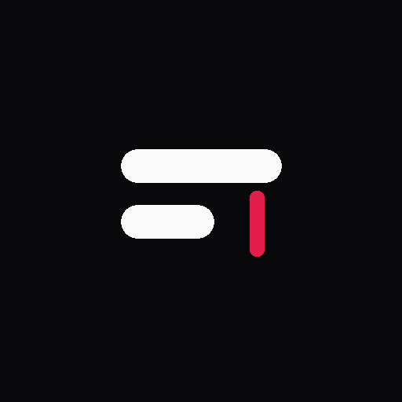

<div align="center">



# SubNexa

### Edit. Sync. Export.

**An offline-first subtitle editor for Android.**
Play a video, fix and sync every subtitle line while it plays, and export a clean SRT or VTT file.

<br/>

[](https://github.com/pabitra-senpai/SubNexa/releases/latest/download/SubNexa.apk)

[](https://github.com/pabitra-senpai/SubNexa/actions/workflows/build-apk.yml)


</div>

---

## About

SubNexa is a **subtitle editor, not a video editor**. Your video is only a playback reference. SubNexa never modifies, converts or re-encodes it, and nothing ever leaves your phone.

It is built for the common problem of a subtitle file that is slightly off: wrong timing, typos, broken lines, or a different encoding. Open the video, import the subtitle, fix it while watching, and export.

## Features

| | Feature | Details |
|---|---|---|
| ▶️ | **Playback** | Play local videos through the Android file picker (MP4, MKV, MOV, WebM, depending on your device codecs). Seek bar, fullscreen and speed control (0.5x to 2x). |
| 📥 | **Import** | Load `.srt` and `.vtt` files. Encoding is detected automatically, so **Bengali, Hindi and English** text displays correctly. Malformed blocks are skipped instead of breaking the whole file. |
| ✏️ | **Edit** | Change text and timestamps, add, delete (with undo), duplicate, split at the playhead and merge entries, all while the video plays. |
| ⏱️ | **Sync** | Shift every subtitle by ±0.5 s, ±1 s or a custom offset. Fine-tune a single line with "Set to now". |
| 🎨 | **Style** | Live subtitle preview with adjustable size, color, background and position (top, middle, bottom). |
| 💾 | **Export** | Save as SRT or VTT (UTF-8) with your own filename and folder. Existing files are never overwritten. |
| 🔁 | **Resume** | Recent projects remember your video, subtitles, playback position and style. Autosave keeps your work safe. |

## Download

1. Open the [**latest release**](https://github.com/pabitra-senpai/SubNexa/releases/latest) or tap the **Download APK** button above.
2. Download `SubNexa.apk` on your Android phone.
3. Tap the file to install. If Android asks, allow installing from your browser or file manager.

> Requires **Android 8.0 (API 26)** or newer.

## How to use

1. **Open video:** tap to pick a video from your phone.
2. **Import subtitles:** pick an `.srt` or `.vtt` file.
3. **Edit:** tap a line to change its text or timing. Long-press a line to duplicate, split or merge it.
4. **Sync:** use the sync sheet to shift all subtitles earlier or later until they match the audio.
5. **Export:** choose SRT or VTT, set a filename and folder, and save.

## Privacy

- No account, no internet access, no analytics, no ads.
- The app requests **no permissions** (even `INTERNET` is removed in the manifest).
- Files are accessed only through Android's Storage Access Framework, and only the ones you pick.
- SubNexa writes only the subtitle file you choose to export. Your video is never changed.
- Projects are stored in app-private storage. Deleting a project from the list never deletes your files.

## Tech stack

| Area | Choice |
|---|---|
| Language | Kotlin |
| UI | Jetpack Compose, Material 3, Navigation Compose |
| Playback | AndroidX Media3 (ExoPlayer) |
| Settings | Jetpack DataStore (Preferences) |
| Projects | JSON files in app-private storage |
| Async | Kotlin Coroutines and Flow |
| Build | Gradle (Kotlin DSL), AGP 9, version catalog |

## Project structure

```
app/src/main/java/com/subnexa/app/
├── MainActivity.kt
├── data/            # Project and settings repositories
├── domain/
│   ├── model/       # SubtitleEntry, Project, appearance models
│   ├── parser/      # SRT / VTT parsing, encoding detection, time utils
│   └── exporter/    # SRT / VTT export
└── ui/
    ├── home/        # Recent projects
    ├── editor/      # Editor, video overlay, bottom sheets
    ├── settings/    # Default subtitle appearance
    ├── components/  # Shared composables
    └── theme/       # Colors, typography, theme
```

## Build from source

Requirements: **JDK 17**, **Gradle 9.3.1** and the Android SDK (platform 36).

```bash
git clone https://github.com/pabitra-senpai/SubNexa.git
cd SubNexa

# the debug build expects a debug.keystore in the project root
keytool -genkey -v -keystore debug.keystore -storepass android \
  -alias androiddebugkey -keypass android -keyalg RSA -keysize 2048 \
  -validity 10000 -dname "CN=Android Debug,O=Android,C=US"

gradle assembleDebug
```

The APK is created in `app/build/outputs/apk/debug/`.

Run the unit tests (subtitle parser and time utilities):

```bash
gradle testDebugUnitTest
```

## Automatic builds and releases

GitHub Actions builds the app on every push to `main`:

- The APK is attached to the rolling [**latest**](https://github.com/pabitra-senpai/SubNexa/releases/tag/latest) release.
- Pushing a tag such as `v1.0.0` publishes a numbered release with generated notes.

```bash
git tag v1.0.0
git push origin v1.0.0
```

## Roadmap ideas

- ASS / SSA subtitle support
- Waveform view for easier timing
- Find and replace across all lines

## Contributing

Bug reports and ideas are welcome. Please [open an issue](https://github.com/pabitra-senpai/SubNexa/issues) with your Android version, device and, if possible, a sample subtitle file.

---

<div align="center">

Made with ❤️ for people who care about good subtitles.

</div>
